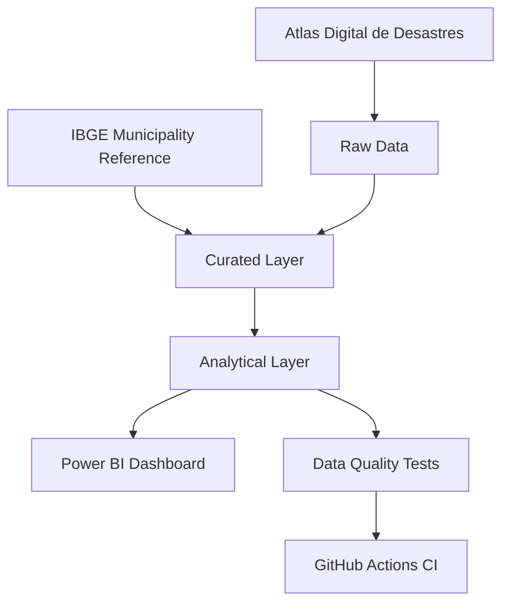
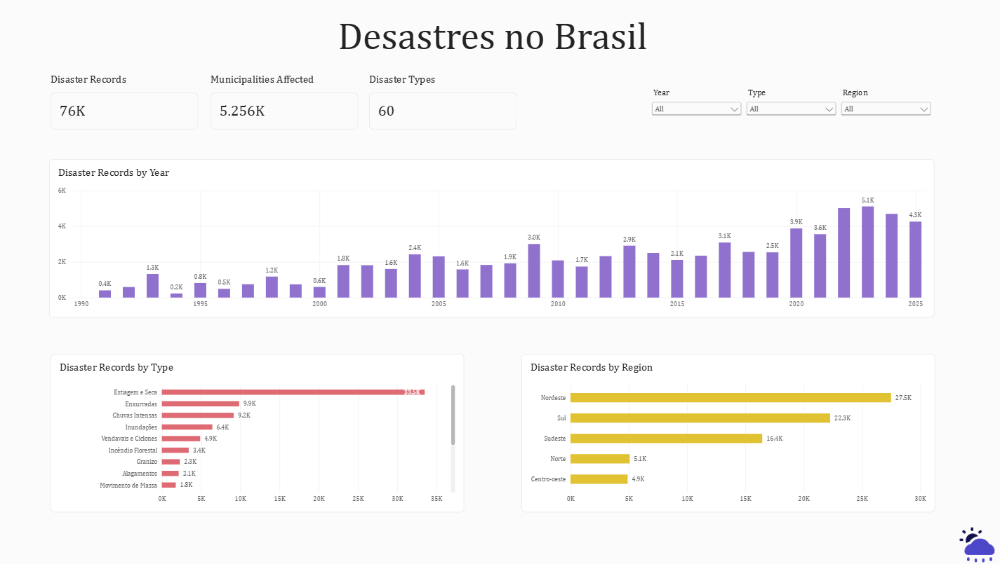
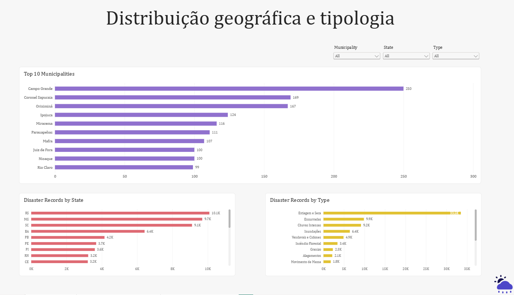
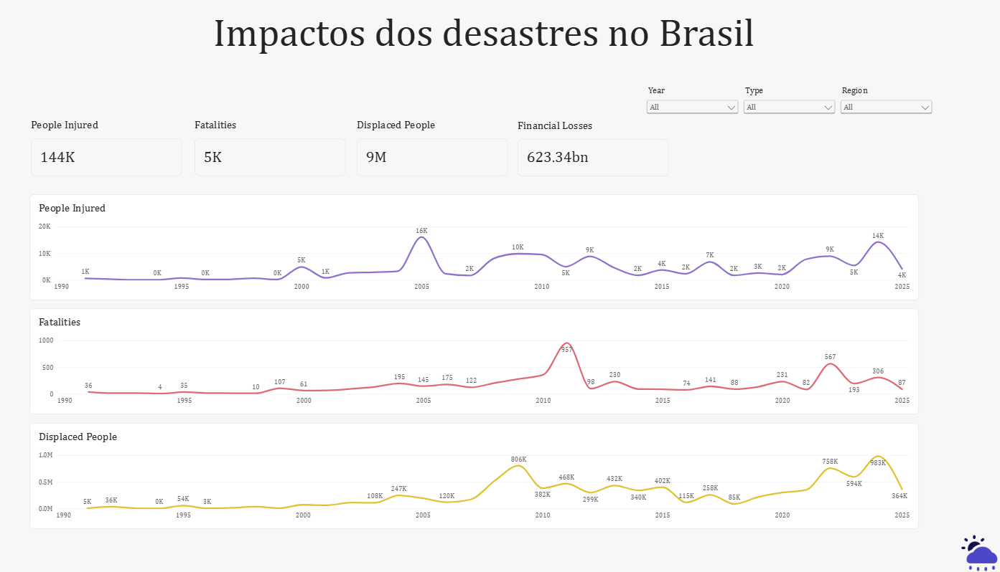

# Brazil Disaster Data Engineering Pipeline

An end-to-end data engineering portfolio project built using Brazil's Atlas Digital de Desastres dataset.

The project transforms public disaster records into a curated dataset and a dimensional analytical model, with automated data quality validation and a Power BI dashboard.

## Project Overview

The pipeline processes disaster records, standardizes municipality information using official IBGE reference data, and builds an analytical model for reporting and exploration.

Key objectives:
- Build reproducible data transformations.
- Improve data consistency and quality.
- Implement dimensional modeling.
- Automate data validation with Pytest and GitHub Actions.
- Support analytical reporting with Power BI.

## Architecture



The pipeline is organized into three layers:

- **Raw:** Original source data.
- **Curated:** Cleaned and standardized disaster records enriched with official municipality names from IBGE.
- **Analytical:** Dimensional model designed for reporting and analysis.

## Analytical Model

The analytical layer follows a star schema:

| Table | Description |
|---|---|
| `fact_disasters` | Disaster records and impact measures |
| `dim_municipality` | Municipality and geographic attributes |
| `dim_disaster_type` | Disaster classifications based on COBRADE codes |
| `dim_date` | Calendar attributes for event and registration dates |

The fact table preserves one row per source protocol record.


## Power BI Dashboard

The Power BI report explores disaster records across Brazil, including their temporal, geographic, and categorical distribution, as well as disaster impacts.

### Overview



### Geographic Distribution



### Disaster Impacts



[Download the Power BI report](reports/atlas_disasters.pbix)

## Data Quality and Testing

The pipeline includes validation for:

- Unique and non-null primary keys.
- Referential integrity between fact and dimension tables.
- Preservation of source record counts.
- Date-key consistency.
- Municipality reference matching against IBGE data.

Automated tests use Pytest and run through GitHub Actions on pushes and pull requests to the `main` branch.

## Technologies

- Python and Pandas
- Parquet
- Pytest
- Git and GitHub
- GitHub Actions
- Amazon S3
- Power BI

## Project Structure

```text
data/
  src/                 # Transformations and analytical modeling
docs/
  images/              # Dashboard screenshots and visual documentation
exploration/           # Data profiling and validation scripts
reports/               # Power BI report
scripts/               # Data upload scripts
tests/                 # Automated tests
.github/workflows/     # CI workflow
```

Raw and processed datasets are excluded from version control. They can be regenerated by running the pipeline with the required source data.

## Project Status

- [x] Curated dataset built and validated
- [x] Dimensional analytical model implemented
- [x] Automated tests created
- [x] GitHub Actions CI configured
- [x] Power BI dashboard created
- [x] Project published on GitHub

## Project Goals

Demonstrate practical data engineering skills through reproducible transformations, dimensional modeling, data quality controls, automated testing, cloud storage integration, and analytical reporting.
